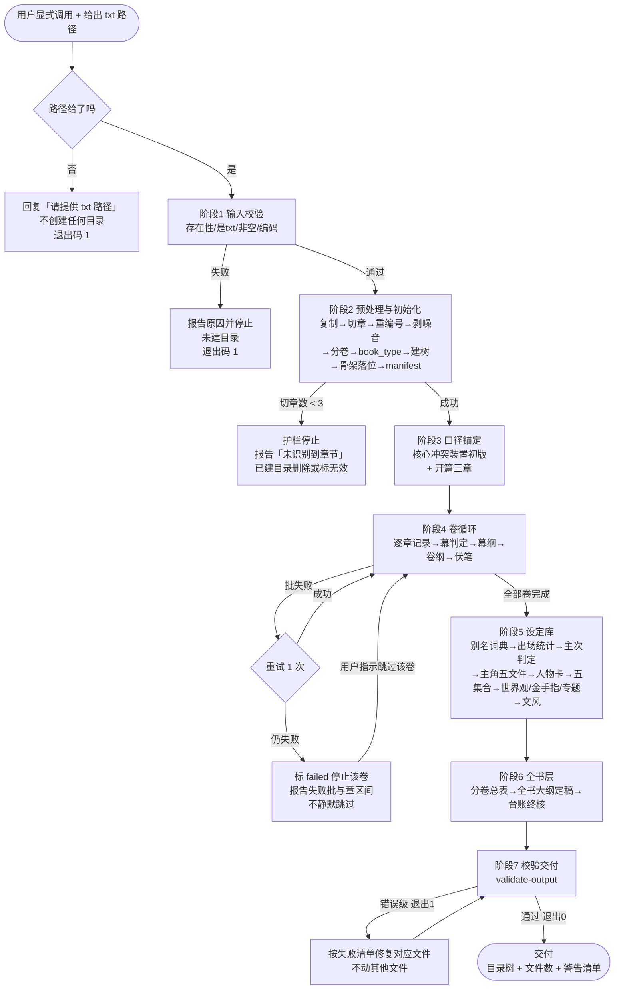
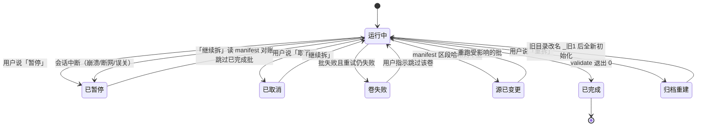
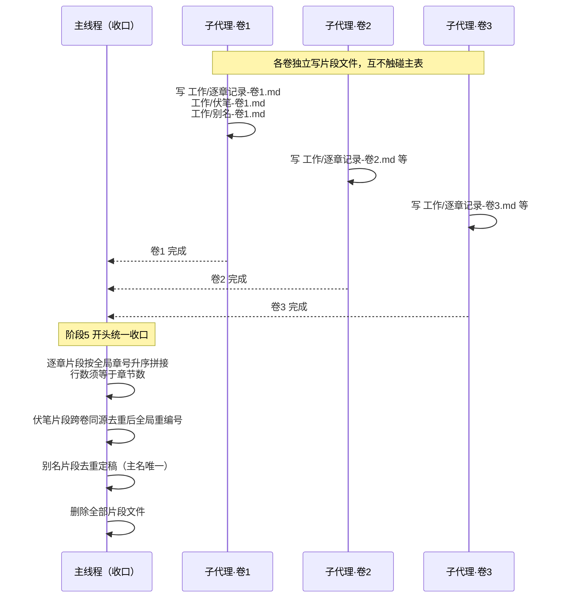

# enki 产品需求

| 字段 | 值 |
|---|---|
| 状态 | 草案 |
| 版本 | v7 |
| 最后更新 | 2026-10-23 |

本文件写给要改这个项目的人。读完应当能判断：拆书产出什么、什么不在范围内、怎样算做完。端到端运行流程（先问什么、何时初始化、各阶段顺序）见本文「产品流程」节。

v2 依据真书反推重定全部模板；v3 将金手指升为必选单体、主角改一人一文件夹解构；v4 将六个专题槽位改为常驻，并规定模板统一骨架；v5 新增开篇三章专项产物与文风定量指纹段；v6 模板文件由「版式」更名「模板」；v7 依据《模板字段审查》补策略空挂字段与故事设计层（Q-23/Q-24）。各版裁定已落入本文件的开放问题表与技能模板/判据。字段与段名的精确取值写在技能模板 `skills/book-breakdown/assets/`，本文件只定规则。

## 背景与问题

网文作者想复用别人的结构，但拿到一本几十万到几百万字的小说时，缺一个能落地的拆解产物：章节摘要太浅，读完了还是不知道「这本书是怎么搭起来的」；笔记太散，写在新文件里，回头找不到。

现有 `book-breakdown` 只产出一份报告，解决不了「按层复用」的问题：想学全书结构、想学某一卷的节奏、想查某个设定，都得重新翻原文。

需要一套固定目录、固定文件名、可校验的拆书产物，让结构本身可被检索和比对。

## 目标

- 一本书一次拆解，产出一个 `<书名>_拆解/` 目录，目录结构固定。
- 四层剧情骨架与伏笔台账齐全：全书大纲、分卷总表、每卷卷纲、每幕幕纲、伏笔台账。
- 世界观与金手指两个必选单体、六个常驻专题槽位、五个集合目录齐全，缺一项即视为未完成；集合里的每个条目一个文件，主角一人一文件夹详细解构。
- 全书另产文风与作者自述两份单体；过程层落盘逐章记录与别名词典。
- 所有 Markdown 文件的段名可被脚本校验，不合格时明确报出文件与缺哪一段。
- 拆解完成后，用户只看目录就知道「这本书怎么搭的」，不需要回翻原文。
- **全自动**：用户给一次路径，之后不再打断、不再询问，直到产物通过校验或明确失败。

## 成功指标

目标里「用户只看目录就知道这本书怎么搭的，不需要回翻原文」是产品承诺，此前没有任何验收项测它。本节把它和另外四条落成可判定的指标。

分两级：**可脚本测**（进 `validate-output` 或测试）与**需人判定**（抽样盲测）。只有前一级能进 CI，后一级靠交付抽查。

| 编号 | 指标 | 基线（做到算合格） | 测法 | 级 |
|---|---|---|---|---|
| M-01 | 出处覆盖率 | 剧情与设定文件中，带「第 N 章＋引句」的条目 ≥95%（首次真书实测 299 条 88.6% 未达标；《长安的荔枝》七阶段跑通后 215 条 100%，说明达标可达） | `verify-quotes.mjs` 统计 pass/(pass+wrong+not-found) | 脚本 |
| M-02 | 段名完整率 | 100%——任一产物缺一个固定段名即不合格。这是硬门槛，不打折 | `validate-output` 的 `E_SECTION` 计数为 0 | 脚本 |
| M-03 | 条目可查率 | 集合索引里每行的文件路径都存在，且每行的分类子目录与索引列一致，100% | `validate-output` 的 `E_INDEX`/`E_PATH` 计数为 0 | 脚本 |
| M-04 | 不回翻原文可用性 | 抽 5 个问题（如「第 3 卷主角的对手是谁」「这条伏笔在哪回收的」），只看产物能答对 ≥4 个 | 盲测：出题人只读原文定答案，答题人只读产物 | 人判 |
| M-05 | 规模预告准确率 | 初始化时报出的「章数/卷数/批数」与最终产物实际值一致，误差 0 | 比对 manifest 初始化值与终态值 | 脚本 |
| M-06 | 单本成本可视 | 每本书跑完能报出本次 token 消耗与各阶段占比，误差不参与判定（只要求有数） | `scripts/cost.mjs`：各阶段 `--record` 累加进 `manifest.cost`，交付前 `--report` 出表；完全无记录时 `--check` 退出 1 | 脚本 |

M-06 是「没有计量就没有优化」的具体化：成本模型（见「非功能需求·成本模型与采样边界」）是估算值，只有真跑出数才知道优化是否生效。

计量刻意做成「记录 + 核对」两件事，而不是只信上报值：

- **记录**：`cost.mjs --record --stage N --in X --out Y`，逐批/逐阶段累加进 `manifest.cost`（不新增产物文件——`工作/` 仍只有三个）。
- **核对**：`--report` 同时算出一个**确定性下界**——阶段 4 必须把全书读一遍，故其输入不可能低于 `全书字数 ÷ 1.6`。上报值低于下界即报 `W_COST_UNDER`，说明有批次漏记。
- 只记不核等于允许自己填一个好看的数字；只核不记等于永远不知道真实量。两者必须同时存在。

三条明确不列入指标的，避免自欺：

- **不测「拆得准不准」**——那需要人工判定全书结构，成本高于收益；`A-xx` 只测「该有的有没有」。
- **不测「用户满意度」**——单人自用产品，问卷无统计意义。
- **不设「消耗 token 上限」**——上下文预算取决于宿主，本项目无法控制；只在「非功能需求」节声明规模上限。

M-01 的现状要如实说：真书实测 88.6%，未达 95% 基线。差的 11.4% 里，章号不符 3.7%、全书找不到 7.7%。这些是**已量化的已知缺口**，不假装达标。推进方式见开放问题 Q-29。

## 非目标

- 不做「拆解报告」（给读者看的书评式产物），后期单独做。
- 不做跨书对比、不做素材入库（属于 Sumeru）。
- 不做原文的全文检索或向量化。
- 不自动判断「写得好不好」，只还原结构。边界澄清（Q-24）：商业结构分析（追读钩、卖点一句话、商业外证、结局形态）属「可观察、可计数、可复现」的结构还原，不在排除之列；主观价值判断（好看/难看）仍在排除之列。
- 不做出版书独立变体模板，仅按 `book_type=出版` 降级支持。
- **不设人工确认环节**：没有「你先建骨架、我看看再继续」这一步。质量靠校验与出处标注，不靠中途点头。

## 产物结构

一本书产出一个 `<书名>_拆解/` 目录，结构固定。目录外的文件一律不属于产物。

```
<书名>_拆解/
├── 原文/                                  脚本建，交付
│   ├── <书名>.txt                          原文副本，与源文件同名同字节
│   ├── 作者的话.md                         作者自述（Q-25 收窄）：仅卷末总结/完本感言/结构预告，例行附注丢弃计数
│   └── 章节/
│       ├── 0001-第一章 标题.txt             每章一个文件，四位全局序号
│       └── 0002-第二章 标题.txt
├── 工作/                                  脚本建，过程产物
│   ├── manifest.json                      章节表、卷边界判定依据、全局章号映射、book_type、字数、输出路径
│   ├── 别名词典.md                        实体别称→主名映射，出场统计前置
│   └── 逐章记录.md                        一行一章十二列：全局章号/标题/章字数/视角/地点/出场人物/一句话事件/剧情线/伏笔埋收/情绪/章末钩型/爽点标记
├── 故事底本/                               agent 填，交付
│   ├── 故事剧情/
│   │   ├── 全书大纲.md                     四块：故事设计/核心冲突装置/骨架段清单(8-12段)/九节点检查单(骨架段优先)
│   │   ├── 分卷总表.md                     一行一卷，15 列（含对手、追读钩、商业外证常驻）
│   │   ├── 伏笔台账.md                     编号/描述/类型/埋点/强化/回收/回收幕/跨度/涉及实体/重要度/状态
│   │   ├── 开篇三章.md                     前三个叙事单元逐章深拆：钩子/信息投放/人设/章末钩＋套路小结
│   │   ├── 卷纲/
│   │   │   └── 卷01-卷名.md                每卷一份，九段（含冲突与对手、节奏与章末钩画像）
│   │   └── 幕纲/
│   │       └── 卷01-幕01-幕名.md           每幕一份，十段（含对手与对抗、弧号对应）
│   ├── 全书设定/
│   │   ├── 世界观.md                       必选单体
│   │   ├── 金手指.md                       必选单体，九段
│   │   ├── 专题/                          六个槽位常驻：力量体系/成长与资源体系/历史年表/
│   │   │                                  地理图志/时代参照层/规则与铁则；不涉及的题材在槽位内
│   │   │                                  写明「本题材不涉及」＋一句依据＋指向对应槽位
│   │   ├── 人物/                          集合，按主次分三档
│   │   │   ├── 索引.md                     姓名、别称、主次(全局+弧内)、立场、首次出场、文件路径
│   │   │   ├── 人物关系.md                 关系表
│   │   │   ├── 主角/
│   │   │   │   └── <人名>/                 一人一文件夹，五文件：人物卡/成长轨迹/身份与马甲/
│   │   │   │                               目标与动机链/关系与阵营；双主角书允许两个文件夹
│   │   │   ├── 主要配角/                   深化卡：基础卡＋弧线/与主角关系演变/高光章链/决策模式
│   │   │   └── 次要角色/                   基础卡
│   │   ├── 势力与组织/                     集合，按类型分档（含信息网络）
│   │   │   ├── 索引.md                     名称、类型、主次、首次出场、文件路径
│   │   │   ├── 门派/
│   │   │   ├── 国家与政权/
│   │   │   ├── 家族/
│   │   │   ├── 商业与组织/
│   │   │   ├── 信息网络/
│   │   │   └── 其他/
│   │   ├── 地点/                          集合，按类型分档
│   │   │   ├── 索引.md
│   │   │   ├── 国家与区域/
│   │   │   ├── 城市与场所/
│   │   │   ├── 秘境与异空间/
│   │   │   └── 其他/
│   │   ├── 物品/                          集合，按类型分档
│   │   │   ├── 索引.md
│   │   │   ├── 武器/
│   │   │   ├── 法宝与道具/
│   │   │   ├── 材料与资源/
│   │   │   └── 其他/
│   │   └── 概念/                          集合，按类型分档
│   │       ├── 索引.md
│   │       ├── 功法与能力/
│   │       ├── 成长与资源/
│   │       ├── 规则与术语/
│   │       ├── 事件/
│   │       └── 其他/
│   └── 文风.md                            七段：叙述习惯/对话风格/信息延迟手法/幽默机制/固定文体装置/
│                                          定量指纹（脚本生成）/原文样本
└── 拆解报告/                              待实现，本版不创建
```

出版书（`book_type=出版`）与网文建同一套产物树：**卷层照样建**（`分卷总表.md` 与每卷一份 `卷纲/`）。区别只在幕的表达——幕＝原文单元（如「第N幕」），幕纲文件名与网文同形（`卷NN-幕NN-名称.md`），挂在所属卷纲下。

卷层不再是出版书的减法，是因为它本来就不是「出版书没有卷」：实测《龙族3》检出 4 卷（章号重启），《龙族1》《龙族2》是单卷「全书」。此前的「出版书不建卷层」是 `productPlan` 里一个 `bookType` 分支写死的行为，把四层骨架压成了两层，使出版书产物永远处于本文「缺一项即视为未完成」的状态。

| 路径 | 本版创建 | 产出者 | 数量 | 校验 |
|---|---|---|---|---|
| `原文/` | 是 | `prepare.mjs` | 1 份原文 + N 个章节文件 | 字节数与源文件一致 |
| `原文/作者的话.md` | 是 | `prepare.mjs` 剥离归集 | 1（无附注时记「无」） | 正文无附注残留 |
| `工作/manifest.json` | 是 | `prepare.mjs` | 1 | 章节数与实际文件数一致；含卷边界依据、全局章号映射、book_type |
| `工作/别名词典.md` | 是 | agent | 1 | 主名唯一，与人物索引别称列一致 |
| `工作/逐章记录.md` | 是 | agent | 1 表 | 行数＝章节数，十二列齐全（含章字数、剧情线） |
| `故事底本/故事剧情/全书大纲.md` | 是 | agent | 1 | 四块齐全：故事设计、核心冲突装置、骨架段清单、九节点检查单 |
| `故事底本/故事剧情/分卷总表.md` | 是 | agent | 1 | 表头 15 列齐全（可空列由模板注明） |
| `故事底本/故事剧情/伏笔台账.md` | 是 | agent | 1 | 编号连续，状态合法，回收章≥埋点章 |
| `故事底本/故事剧情/开篇三章.md` | 是 | agent | 1 | 四个段名齐全，每章含钩子/信息投放/人设/章末钩四项 |
| `故事底本/故事剧情/卷纲/` | 是 | agent | 每卷 1 份 | 九个段名齐全，卷号连续 |
| `故事底本/故事剧情/幕纲/` | 是 | agent | 每幕 1 份 | 十个段名齐全，每卷幕数＝事件弧数，能对应到卷纲 |
| `故事底本/全书设定/世界观.md` | 是 | agent | 1 | 段名与模板一致 |
| `故事底本/全书设定/金手指.md` | 是 | agent | 1 | 九个段名齐全 |
| `故事底本/全书设定/专题/` | 是 | agent | 固定 6 份 | 六个槽位齐全；不涉及槽位含「本题材不涉及」判定、依据与指向 |
| `故事底本/全书设定/人物/` | 是 | agent | 1 索引 + 1 关系 + 主角每人 5 文件 + 其余角色每人 1 份 | 索引行数与条目数一致（主角一行计一文件夹）；主角文件夹五文件齐全；索引里的路径都存在 |
| `故事底本/全书设定/势力与组织/` | 是 | agent | 1 索引 + 每条目 1 份 | 同上，索引列含类型 |
| `故事底本/全书设定/地点/` | 是 | agent | 1 索引 + 每条目 1 份 | 同上 |
| `故事底本/全书设定/物品/` | 是 | agent | 1 索引 + 每条目 1 份 | 同上 |
| `故事底本/全书设定/概念/` | 是 | agent | 1 索引 + 每条目 1 份 | 同上 |
| `故事底本/文风.md` | 是 | agent＋脚本 | 1 | 七个段名齐全；定量指纹段含七项指标数值（Q-22） |
| `拆解报告/` | 否 | 后期 | 0 | 本版不检查 |

段名与字段的精确取值以 `skills/book-breakdown/assets/` 下同名模板为准。

模板统一骨架：所有模板遵循同一结构——「概念」（定义、目的、边界）→「契约」（填写者与条款指针）→「内容」（字段与结构）。每个产物先写清它是什么、为谁回答什么问题、不包含什么，再列字段。概念定义是防止不同执行者对同一产物产生理解偏差的第一道护栏；填写时的第二道护栏是出处格式（F-14）与判据（`references/`）。

命名：

- 章节序号为全局章号：原文章号每卷重启、多册重编或多体系并存（汉字序号番外）时由脚本统一重编，原号记入 `manifest.json`。
- 卷号两位、从 `01` 起连续；幕号每卷两位、从 `01` 起连续；卷号与幕号在文件名中不重复。
- 卷名、幕名优先取原文标题（卷标题、附注部名、原文「第N幕」），无标记时取该段首章标题关键词；标题含 `\ / : * ? " < > |` 时替换为 `_`。
- 章节文件名取章节标题（剥离求票打赏后缀），同样替换非法字符；四位序号从 `0001` 起（前言为 `0000`）。
- 专题文件名取专题名，如 `力量体系.md`。
- 主角文件夹名取人名主名，五文件名固定：`人物卡.md`、`成长轨迹.md`、`身份与马甲.md`、`目标与动机链.md`、`关系与阵营.md`。
- 其余角色文件名取角色主名；重名时追加首次出场章号，如 `克莱恩-第12章.md`。
- 集合型条目的文件名取条目名，重名规则同上；分类只决定放在哪个子目录，不写进文件名。
- 分类一旦确定不迁移。类型或主次后续变化时，改索引里的列，不移动文件。

文件总数 = 3（大纲、总表、开篇三章）+ 1（伏笔台账）+ 卷数 + 幕数 + 2（世界观、金手指）+ 6（专题槽位）+ 5 个索引（人物、势力、地点、物品、概念）+ 1 关系 + 主角数×5 + 其余角色数 + 条目数 + 2（文风、作者的话）+ 3（manifest、别名词典、逐章记录）。一本 1000 章、4 卷、每卷 5 幕、1 主角、120 人物、60 势力、80 地点、100 物品、50 概念的书约为 3+1+4+20+2+6+5+1+5+119+290+2+3 = 461 份主要文件，另有 `原文/章节/` 下 1000 个章节文件。

## 用户与场景

| 角色 | 情境 | 目标 | 现在怎么解决 |
|---|---|---|---|
| 作者本人 | 读完一本想学的书，要拆它的骨架 | 拿到四层剧情、伏笔台账与全套设定 | 手写笔记，散落各处 |
| 作者本人 | 写到某一卷卡住，想参考同类书的节奏 | 打开该卷的卷纲与幕纲 | 回翻原文，凭记忆 |
| 作者本人 | 想学某本书的伏笔布局 | 打开伏笔台账与卷纲的埋收两列 | 自己记性，千章伏笔必丢 |
| 作者本人 | 想学主角是怎么立起来的 | 打开主角文件夹的成长轨迹与目标动机链 | 回翻原文，凭感觉 |
| 未来的自己 | 半年后想查某本书的某个设定 | 打开对应设定文件 | 找不到，重读 |

## 功能需求

| 编号 | 需求 | 优先级 | 验收 |
|---|---|---|---|
| F-01 | 技能启动后，第一步询问用户提供小说原文 txt 的路径；缺失时停止，不猜路径 | 高 | A-01 |
| F-02 | 校验原文可读、是 txt、非空；不满足时停止并说明原因 | 高 | A-02 |
| F-03 | 把原文复制到产物的 `原文/` 子目录，文件名保持原名 | 高 | A-03 |
| F-04 | 按「产物结构」节建立固定目录树（含 `book_type=出版` 降级分支）并做骨架落位：初始化即生成固定产物的骨架文件（完整段名＋待填占位），分级落位时机见本文「产品流程」节的骨架落位表 | 高 | A-04 |
| F-05 | 全书大纲生成四块：故事设计（主题、logline、欲望与恐惧、对手、弧光终点、读者承诺、结局形态）＋核心冲突装置（贯穿装置及其结构职能）、骨架段清单（8-12 段，每段标段型与起止章）、九节点检查单（节点＋章号＋一句依据） | 高 | A-05 |
| F-06 | 分卷总表一行一卷，15 列（新增本卷主要对手可空、追读钩；商业外证升常驻允许「无」）；「核心压力源」允许非人格化取值 | 高 | A-06 |
| F-07 | 每卷一份卷纲，九个固定段名（「主要冲突」改「主要冲突与对手」，新增「节奏与章末钩画像」），含事件弧清单 | 高 | A-07 |
| F-08 | 每幕一份幕纲，十个固定段名（新增「对手与对抗」；对应段改填卷纲弧号）；幕＝卷内事件弧（每卷通常 2-6 幕），且幕必须能对应到卷纲 | 高 | A-08 |
| F-09 | 生成世界观与金手指两个必选单体、六个常驻专题槽位（不涉及的写明判定与指向）、5 个集合目录（人物、势力与组织、地点、物品、概念）；集合条目一项一文件；主角一人一文件夹五文件 | 高 | A-09 |
| F-10 | 提供 `validate-output.mjs`，逐文件校验段名、表头、幕覆盖、台账编号与状态、逐章行数、出处格式、卡片字段存在性、散文引句密度，退出码 0/1 | 高 | A-10 |
| F-11 | 支持增量：可只重做某一卷或某一幕，不覆盖其他文件 | 中 | A-11 |
| F-12 | 全自动执行：除 F-01 的路径询问外，不中途停下等确认；结束时输出目录树与文件数汇总 | 高 | A-12 |
| F-13 | 三级汇总，避免一次读完整本：章级记录 → 卷级纲要 → 全书大纲；逐章记录十二列（含章字数、剧情线、章末钩型与爽点标记，Q-22/Q-23/D-23）；每批不超过 20 章，每批完成即写入 `工作/逐章记录.md` | 高 | A-13 |
| F-14 | 每条结论标注「第 N 章＋原文引句」出处；给不出出处的条目不写入；设定卡区分首现章与进入章 | 高 | A-14 |
| F-15 | 人物索引一行一角色（主角一行计一文件夹），含姓名、别称、主次（全局＋弧内双口径）、立场、首次出场章、文件路径；关系表两端角色都能在索引中找到 | 高 | A-15 |
| F-16 | 四个集合的索引列与分类子目录按契约生成；分类只写在索引列与子目录里，确定后不迁移 | 高 | A-16 |
| F-17 | 预处理：宽正则切章（章/幕/节/回，含序章、楔子、尾声、终章、番外），全局重编号，剥离六类噪音（作者话→归集、广告水印、(本章完)、更新预告、标题后缀、番外公告）；章节数 < 3 时停止 | 高 | A-17 |
| F-18 | 分卷三级检测：「第X卷」行为权威锚点（防假标记）、章号重启检测、「(第N卷完)」尾标记回推；「单章均长 > 1.5 万字」标记 `book_type=出版` 并降级模板（章数只作防极端硬顶：≥300 章仍按网文） | 高 | A-18 |
| F-19 | 伏笔台账：编号、描述、类型、埋点章、强化章、回收章、回收幕、跨度、涉及实体、重要度、状态（十一列）（未收/半收/已收/续作预留）；优先从复盘章反填再回溯埋点 | 高 | A-19 |
| F-20 | 别名词典先于人物统计生成；主次判定＝出场占比初筛（全局＋分卷双口径）＋视角章占比＋关键事件参与修正；允许双主角/双女主层 | 高 | A-20 |
| F-21 | 文风：七个固定段名（叙述习惯/对话风格/信息延迟手法/幽默机制/固定文体装置/定量指纹/原文样本），定性六段每段附 3-5 个带章号样本；定量指纹由脚本生成（句均长、短句比、对话占比、了密度、疲劳词密度、场景切换密度、情绪标签词密度七项指标，全书值＋最偏离三章，各带章号；后两项为 Q-22 新增） | 高 | A-21 |
| F-22 | 作者自述（原「作者的话」）：仅归集结构相关附注（卷末总结/完本感言/结构预告，classifyNoise 新增「结构附注」类），例行附注（求票/打赏/请假）剥离后丢弃仅计数入 manifest.noise；无结构附注时记「无」 | 高 | A-22 |
| F-23 | 进度与中断管理：manifest 记录阶段/卷/批/文件四层进度；支持暂停、取消（产物保留不删除）、继续拆（断点续跑跳过已完成批）、重拆（旧产物改名归档）、进度查询（读 manifest 即答）；批失败重试一次后停止该卷并报告，不静默跳过 | 高 | A-23 |
| F-24 | 开篇三章专项：前三个叙事单元（网文为前三章，出版书为前三个原文单元）逐章深拆——入场钩子、信息投放节奏、人设立住手段、章末钩，末段总结可复用套路；在阶段 3 口径锚定时一并完成（只读三个单元，成本低） | 高 | A-24 |

优先级判据：不做则核心场景走不通＝高；走得通但有明显损失＝中；改善＝低。

## 验收标准

| 编号 | 标准 | 判定 | 证据位置 |
|---|---|---|---|
| A-01 | 未给路径时，回复含「请提供」与「txt」两个词，且不创建任何目录 | 通过 | `evals/cases/neg-no-input.md` 的 C-01 |
| A-02 | 路径不存在或非 txt 时，回复含失败原因，退出码非 0 | 通过 | `evals/cases/neg-bad-input.md` 的 C-01 |
| A-03 | 产物 `原文/` 下存在与源文件同名的 txt，字节数一致 | 通过 | 脚本核对 |
| A-04 | 产物目录树与契约完全一致（含降级分支），无多余文件 | 通过 | `scripts/validate-output.mjs` |
| A-05 | 全书大纲四块齐全（故事设计七项各有一句话）；骨架段 8-12 段、每段有起止章与段型；九节点各有章号与一句依据 | 通过 | 同上 |
| A-06 | 分卷总表 15 列齐全（对手与商业外证列允许空/无），列名与契约一致（可选列可空） | 通过 | 同上 |
| A-07 | 每份卷纲九个段名齐全，卷号连续 | 通过 | 同上 |
| A-08 | 每份幕纲十个段名齐全；幕纲弧号能在卷纲弧清单找到（外键，警告级）；每卷幕数与卷纲事件弧数一致；卷 NN-幕 MM 能在卷 NN 的卷纲中找到对应弧 | 通过 | 同上 |
| A-09 | 世界观＋金手指＋6 个专题槽位齐全（不涉及槽位有判定、依据与指向）＋5 集合齐全；主角文件夹五文件齐全；每个集合的索引行数等于条目数；文件名与契约一致 | 通过 | 同上 |
| A-10 | `validate-output.mjs` 在完整产物上退出 0，删任一段、列或行后退出 1 | 通过 | `test/validate-output.test.mjs` |
| A-11 | 只重做一卷时，其他卷的文件 mtime 不变 | 通过 | 人工核对 |
| A-12 | 结束时输出目录树与文件数，中途没有询问或等待 | 通过 | 运行记录 |
| A-13 | 处理日志里每批标注了章号区间，单批章数不超过 20；`逐章记录.md` 行数＝章节数 | 通过 | 运行记录 |
| A-14 | 每份剧情与设定文件中，条目均带「第 N 章」出处，无裸条目（错误级）；引述型条目按文件密度查引句，≥3 条且覆盖率 <50% 报警告（Q-30：坐标行、否定式说明、分工说明与「揭示节奏/使用记录」等坐标段不进分母） | 通过 | `scripts/validate-output.mjs` |
| A-15 | 关系表每行两端的角色都出现在索引里，索引里的文件路径都存在；主次含全局与弧内两个值 | 通过 | 同上 |
| A-16 | 每个集合目录下只有契约白名单里的子目录；索引每行的路径都存在且落在对应分类目录下 | 通过 | 同上 |
| A-17 | 宽正则切章对样本文本零误报；产物正文无附注残留；章节数 < 3 时退出非 0 | 通过 | `test/prepare.test.mjs` |
| A-18 | 三级检测对样本（标准卷标记、章号重启、尾标记）卷界与证据一致；出版书样本标记 `book_type=出版`，且**卷层产物齐全**（每卷一份卷纲、有分卷总表、幕纲份数＝原文单元数）；同套书不同分册判定一致（龙族 1/2/3 实测：11、21、58 章均判出版） | 通过 | 同上 |
| A-19 | 台账编号连续、状态枚举合法、回收章≥埋点章；抽 3 条伏笔的埋收章可在原文复核 | 通过 | 人工核对 |
| A-20 | 别名词典主名唯一；人物主次含双口径值；别名并集与单名差 ≥10 倍的样本归并正确 | 通过 | `scripts/validate-output.mjs` |
| A-21 | 文风七段齐全，定性六段每段至少 3 个带章号样本；定量指纹段含七项指标数值（含场景切换密度、情绪标签词密度）及偏离章出处 | 通过 | 同上 |
| A-22 | 作者的话四段齐全，或明确记「无」 | 通过 | 同上 |
| A-23 | 中断后「继续拆」：已完成批零重复处理（运行记录比对批号与耗时），产物无重复段；「重拆」后旧目录以归档名原样存在；进度查询能答出阶段、卷、批完成度 | 通过 | 运行记录＋人工核对 |
| A-24 | 开篇三章四段齐全，每章拆解含钩子、信息投放、人设、章末钩四项且带章内出处（原文引句）；可复用套路 ≥3 条 | 通过 | `scripts/validate-output.mjs`＋人工核对 |

## 假设、约束与依赖

| 类型 | 内容 | 不成立时 |
|---|---|---|
| 假设 | 原文是纯文本 txt，章节标题可用宽正则（第N章/幕/节/回、序章、楔子、尾声、终章、番外）识别 | 识别失败时停止并报告，不硬切 |
| 假设 | 单章长度在上下文预算内；超长章单独成批 | 单章超预算时按段落再切，并记录切分点 |
| 假设 | 盗版 txt 可能含水印、丢引号、剥间隔号；清洗后仍损伤时，文风与对话分析标注「文本质量受限」 | 同左 |
| 假设 | 非常规叙事书（认知翻转、双重世界）的「唯一真相」不自动裁决，产物显式「未决/双重记录」状态 | 同左 |
| 约束 | 不把整本原文写进仓库；产物目录中的 `原文/` 由 `.gitignore` 排除 | 提交前会被钩子拦下 |
| 约束 | 全自动，不设人工确认；质量由校验与出处标注保证 | 校验失败时输出失败清单，不静默通过 |
| 依赖 | Node.js 24 及以上，零外部依赖 | 低于 24 时脚本报错退出 |
| 依赖 | 用户机器上能读写的输出目录 | 无写权限时停止并说明 |

## 非功能需求

目标里说「几十万到几百万字」都能拆，但从未给出边界、成本与资源占用。本节补齐，作为承诺的另一半——不写边界的承诺等于没有承诺。

### 规模边界

| 项 | 值 | 依据 |
|---|---|---|
| 支持章数 | 3 – 3,000 章 | 下限是护栏（A-17）；上限来自实测最大样本（大奉 1,700+ 章、诡秘 1,400+ 章）留一倍余量 |
| 支持字数 | 至约 1,500 万字 | 均章 5,000 字 × 3,000 章 |
| 超过上限时 | 不拒绝，但初始化报告须提示「超出实测范围，可能耗时很久或中断」 | 拒绝会让用户没法用；静默接受会让用户等一整天 |
| 单章上限 | 无硬上限；超 3 万字单独成批 | 假设「单章在预算内」的兜底 |
| 批次大小 | ≤20 章 | F-13；上限来自上下文预算 |

### 资源占用

| 项 | 估算 | 说明 |
|---|---|---|
| 产物磁盘（1,000 章 / 461 份文件） | 原文副本 1 份 + 章节文件 1,000 份 + 正文产物约 461 份；**约为原文字节数的 2–3 倍** | 章节文件是按章切分的原文，故主体是原文的重复；想省空间可只保留原文不切章，但会牺牲断点续跑的粒度 |
| 产物磁盘（3,000 章） | 约 3 倍原文字节 | 同比例 |
| 内存 | 脚本全程流式处理，不整本载入 | `prepare` 按行读，一次只持有一章 |
| 网络 | 不需要 | 零依赖、无外部调用 |

### 成本模型与采样边界

拆解的成本几乎全在「读原文 + 产出内容」的 token 上，脚本本身不花 token。以一本 300 万字、1,000 章、均章 3,000 字的书估算（中文按 1.6 字/token）：

| 阶段 | 优化前 | 第一轮 | 第二轮 | 第三轮（当前） | 怎么省的 |
|---|---|---|---|---|---|
| 阶段 4 卷循环 | 6.56M | 1.88M | 1.88M | 1.88M | `write-rows.mjs` 按章号写行，不再每批读整表 |
| 阶段 5 设定库 | 6.15M | 3.08M | 0.12M | **0.12M** | 实体索引定位 → 按档位采样 → `quote-finder.mjs` 只取命中句，不再读整章 |
| 判据与方法论加载 | 0.22M | 0.22M | 0.22M | **0.02M** | `references/索引.md` 给出行范围，按节读；组间不重读 |
| 阶段 3/6/7 | 约 0.1M | 约 0.1M | 约 0.1M | 约 0.1M | 已是脚本或小样本 |
| **合计** | **约 13.0M** | **约 5.3M** | **约 2.3M** | **约 2.2M** | **降约 83%** |

三轮的差别：

1. **第一轮只是「少读几章」**——阶段 4 不再每批读整张表。
2. **第二轮是「不再为找一句出处读整章」**——阶段 5 的大头不是卡多，是同一本书被读了第二遍（410 张卡各读约 3 章 ≈ 1,230 章、约 370 万字，比阶段 4 读全书还贵）。改为脚本定位命中的句子后，这部分从 3.08M 降到 0.12M。
3. **第三轮是「判据只读用得上的那几节」**——`人物提炼策略.md` 约 2 万字（≈20k tokens）、`设定提炼策略.md` 约 1.85 万字（≈11.6k tokens）。阶段 5 按七组推进，若每组整读这两份，最坏是 0.22M；按节读（主角组四节、配角组两节、反派组一节、四集合一节、专题一节）合计降到 0.024M，降约 89%。

耗时为宿主模型速度的函数，估算区间：优化前 25–40 小时，第一轮 8–12 小时，第二轮约 6–9 小时，第三轮约 5–8 小时。

**首次真书实测（2026-10-23，《长安的荔枝》）**：一本 6 章、8.6 万字的单卷短书已完整跑完阶段 3–4，这是上表第一次拿到实测数而非估算数。结论分两半，一好一坏：

- **输入侧完全吻合，模型可信**。实测全书 86,596 字 → 读入 54,123 tokens（0.625 tokens/字，即 1/1.6）。按此率外推 300 万字 = **1.88M**，与上表阶段 4 的 1.88M 一字不差。这条最重要的估算被证实了。
- **产出侧的量纲此前没写清，实测纠正过来**。逐章记录按**章数**放大而非字数：实测单行为 161 字符（约 100 tokens，12 列全填）。1000 章 = 161,000 字符 = **约 101K tokens**；加上 10 份卷纲（38K）、约 50 份幕纲（67K）、伏笔台账（2K），阶段 4 的产物合计约 **208K tokens**。上表「阶段 3/6/7 约 0.1M」低估了这一块，真实值应是阶段 4 产物约 0.21M。

实测同时暴露了一个工具缺陷并已修复：`cost.mjs` 的 `W_COST_UNDER` 原先把下界全压在阶段 4 上（要求阶段 4 输入 ≥ 全书），但阶段 3 已读过开篇三章，实际是「阶段 3+4 合计 ≥ 全书」。照旧规则跑这本 6 章书必然误报（阶段 4 单独 41.3K < 全书 54.1K）。已改为下界 = 全书 − 阶段 3 所读开篇三章，并同时输出「合计下界」供核对。

**全书七阶段跑通后的成本实测（2026-10-23 补记）**：上表之外，这本 6 章书已把阶段 3–7 全部跑完。五阶段实测合计 **输入 94.1K、输出 57.2K**，其中阶段 5（设定库）输出 35.8K、占总输出 63%。据此校正上表的产出侧估算：

- **产物输出被低估约 3.3 倍**。实测产物 62 个文件、净 83,411 字 ≈ **52.1K tokens**（剧情 16.4K ＋ 设定库 35.8K）。上表「阶段 3/6/7 约 0.1M、产物输出合计 15.9K × 34.6 = 0.46M」需上调为 **约 1.5M**，全书总额从 2.34M 上调至 **约 3.4M**。
- **低估的根源不是量纲，是密度**：设定库按「每张卡逐段写作」产出，非模板填充。真书实测人物卡 17 张（主角五件套＋主要配角 6 张＋次要角色 10 张）、专题 6 份、概念卡 3 张、势力卡 4 张、地点卡 4 张、物品卡 5 张，平均单卡 600–2,100 字。这项成本随「实体数」放大，而不是随「章数」放大——1000 章的书若实体数在 100–200 量级，设定库约 60K–120K tokens，仍是阶段 5 的最大项。
- **输入侧的分段结构也已实测**：阶段 3 12.9K、阶段 4 41.3K、阶段 5 20.0K（读设定所需的技术与人物上下文）、阶段 6 8.0K（全书层回核）、阶段 7 12.0K（校验与修复循环）。阶段 4 占输入 44%，是唯一可优化项，但按上文采样边界的结论，这 44% 省不得。

实测还暴露了采样边界的真实代价，这点比 token 数更值得记：本次为省成本，阶段 4 首轮只读了全文的 32%（每章的首尾若干段），写出的幕纲漏掉了**大量关键情节**——第二章何履光要把他「沉珠江」、卖符牒谈成九百九十六贯、第三章荔枝酒宴上给林邑奴敬酒（第 4 章报恩的真正埋点）、第四章林邑奴死前设局诱虎反杀十名牙兵、第五章苏谅在生辰当日决裂、第六章当面质问杨国忠被打到吐血。补读全部原文后，卷纲的关键事件链从 15 条扩到 37 条，伏笔台账从 14 条扩到 21 条，四份幕纲的五拍重写。结论：**阶段 4 读全书没有折扣可打**，省下来的 token 会以「产物漏情节」的形式还回去，而漏情节是产品定义层面的失效，不是省钱。

**口径说明**：以上 token 一律按「字符数 ÷ 1.6」估算。曾有一版按 UTF-8 字节数除 1.6，把中文体量虚高约 3 倍（中文一字 3 字节），导致 `人物提炼策略.md` 被记成 50k tokens 而非实际的 20k。`references/索引.md` 与本文数字均按字符口径，测试里有一条专门盯住不许再出现按字节错算的旧值。

**单模型约束下的取舍**：若可用模型不止一种，把阶段 4 的机械抽取（受控枚举、结构固定）换到便宜模型是最大的一笔；当前按「全程同一模型」设计，故不采用分层模型，改为从读取量上省。

**采样边界（不可越界）**：

- **骨架全量**：逐章记录必须一章一行，1,000 章就是 1,000 行。它是四层骨架的地基，采样即失去「结构还原」这一产品定义。
- **详情卡采样**：人物卡、集合条目卡的取证章数按 `workflows/08-设定库.md` 的分档上限执行（主角 ≤6 章、次要角色 ≤2 章、条目 ≤3 章），证据不足时用逐章记录的摘要列补，不扩读原文。
- **引句定位不降质**：`quote-finder.mjs` 是确定性检索（按别名词典展开称呼、按 manifest 定位章节文件），不是让模型猜；它只缩小「读哪几句」，不替代「引句必须核对」这一步。

这条边界的依据：同类开源项目 `novel-deconstruct` 能做到「前三章全文 + 中间抽样 + 末十章全文，全书只读 20–30 章」，是因为它只出**评价报告**；本产品要还原完整结构，骨架不能采样，但卡片可以。

### 幂等性

同一本书重复执行必须收敛到同一状态，不叠加副作用。

| 操作 | 幂等性 | 机制 |
|---|---|---|
| `prepare` 重入 | 幂等 | 产物目录已存在则不重建，走 manifest 对账；不覆盖已填文件 |
| `prepare --force` | 非幂等（有意为之） | 旧目录改名归档为 `_旧N`，再全新初始化；归档不删除 |
| `validate-output` | 幂等 | 只读不写，任意次运行结果相同 |
| 阶段 4 批重跑 | 幂等 | 按批号与输入区段哈希判定，已完成批跳过 |
| 并行片段合并 | 幂等 | 已合并的片段在校验通过后才删；重跑重新合并同一批片段得同一结果 |

### 隐私与数据

| 项 | 规则 |
|---|---|
| 原文归属 | 用户自己的书，全程本地处理，不上传、不联网 |
| 原文副本 | 落在产物 `原文/` 下，同级于源文件；`原文/` 由 `.gitignore` 排除，不进仓库 |
| 引句留存 | `verify-quotes` 与产物中的「原文引句」是**必要的工作痕迹**，非全文；单条引句建议 ≤200 字（只够定位，不构成可替代原文的片段） |
| 产物分享 | 产物含用户原文引句，**由用户自行判断**是否分享；本工具不做脱敏，因为脱敏会破坏出处核验能力 |
| 语料不入库 | 本仓库永不提交任何原文，只写路径 |

## 产品流程

#### 主流程图

从用户给出路径到交付的完整链路，含失败出口。矩形为脚本执行、圆角为 agent 执行、菱形为判定。



三条贯穿全流程的横向规则（图中未画，避免线网过密）：

- **进度落盘**：每批完成即写 manifest，阶段/卷/批/文件四层状态。任何时刻中断都能对账续跑。
- **全自动**：只有阶段 0 询问一次，此后无确认节点。失败即停即报，不问「要不要继续」。
- **骨架先行**：初始化即生成全部产物骨架（段名齐全＋「待填」占位），任意时刻目录都是「完整骨架＋部分已填」。

#### 异常与中断的状态流转

主流程之外的六种非正常路径。这张图定的是「产物会变成什么状态」，不是操作步骤。



产物在任何状态都保留、不自动删除（脚本无删除操作）。「已取消」与「已暂停」的区别只在意图记录，产物状态相同——两者都能用「继续拆」恢复。

#### 并行执行的片段合并

阶段 4 与 5 支持多代理按卷并行。这是全流程最易实现错的一段，规则写死如下。



四条硬约束：

1. **片段文件名固定**：`逐章记录-卷N.md`、`伏笔-卷N.md`、`别名-卷N.md`，N 为两位卷号。子代理只写自己的片段，不写主表。
2. **收口在阶段 5 开头**，不散落在阶段 4 结尾——因为阶段 4 结束时可能还有卷在跑。
3. **合并可重入**：收口失败（如某卷片段缺行）时报出缺哪卷哪批，不删片段；已合并的片段保留到全部校验通过后才删。
4. **串行是默认**：只有卷数多或单卷超上下文时才转并行。串行直接在主表上写，无片段、无合并。

#### 流程总览

| 阶段 | 触发 | 执行者 | 产出 | 用户可见 |
|---|---|---|---|---|
| 0 路径询问 | 用户要求拆一本书 | agent | 原文路径 | 一句询问（全流程唯一一次） |
| 1 输入校验 | 拿到路径 | 脚本 | 通过／失败原因 | 失败时一句原因 |
| 2 预处理与初始化 | 校验通过 | 脚本 | 原文副本、章节文件、manifest、目录树、骨架文件 | 初始化报告：章数、卷数、批数（规模预告）、字数、book_type、目录树 |
| 3 口径锚定 | 初始化完成 | agent | 全书大纲「核心冲突装置」初版；`开篇三章.md`（顺带，只读三个单元，F-24） | 一行摘要 |
| 4 卷循环 | 锚定完成 | agent | 逐章记录、幕纲、卷纲、伏笔台账 | 每批一行进度日志（批号＋章号区间） |
| 5 设定库 | 卷循环完成 | agent | 别名词典定稿、主角文件夹、人物卡、五集合、世界观/金手指/专题、文风 | 一行摘要 |
| 6 全书层 | 设定库完成 | agent | 分卷总表、全书大纲定稿、台账终核 | 一行摘要 |
| 7 校验与交付 | 全书层完成 | 脚本＋agent | 校验结果、修复、交付汇总 | 目录树＋文件数＋警告清单 |

#### 各阶段细则

#### 阶段 0：路径询问（F-01）

agent 询问小说原文 txt 的路径。用户未给路径时停止，不猜路径、不创建任何目录。书名缺省取文件名去扩展名（PRD 输入表）。

#### 阶段 1：输入校验（F-02）

脚本校验：路径存在、是 txt、非空；编码检测，非 UTF-8 时按 D-10 转码到产物副本。任一不过：报告原因，停止，未建目录。

#### 阶段 2：预处理与初始化（F-03、F-04、F-17、F-18）

脚本依次：复制原文 → 宽正则切章（含噪音阈值，D-13）→ 全局重编号 → 六类噪音剥离 → 作者的话归集 → 三级分卷检测（D-04）→ 出版书判定（D-09）→ 建目录树 → **骨架落位** → 写 manifest（受管状态块，D-12）。

骨架落位（骨架先行）：初始化不只建目录，同时按分级落位表生成产物骨架文件——骨架文件含完整段名标题与「待填」占位，用户此刻就能看到产物全貌。

| 时机 | 落位内容 |
|---|---|
| 初始化立即 | `原文/` 全部、`工作/` 三件（逐章记录的章号与标题列已填）、作者的话、全书大纲、分卷总表、伏笔台账、世界观、金手指、六专题槽位、文风的骨架；五集合目录与索引骨架 |
| 分卷检测后 | 卷纲骨架（每卷一份，卷名卷号已填） |
| 幕判定后（阶段 4） | 幕纲骨架（每幕一份） |
| 主次判定后（阶段 5） | 主角文件夹骨架（五文件） |
| 要素提取后（阶段 5） | 五集合条目卡 |

失败分支：切章数 <3 时停止并报告（护栏），已建目录删除或标记无效，不进入后续阶段。

#### 阶段 3：口径锚定（D-11）

agent 读开篇抽样章与作者附注，先产出全书大纲的「核心冲突装置」初版，作为后续所有卷的口径锚；此时尚不写骨架段清单与九节点（那是阶段 6 的事）。同批完成 `开篇三章.md`（本来就要读前几章，零额外读取成本，F-24）。

#### 阶段 4：卷循环（F-13，按卷一次一卷）

支持两种执行形态：单代理逐卷串行；或多代理按卷并行——并行时逐章记录、伏笔台账、别名词典先写分卷片段（`工作/逐章记录-卷N` 等），收口阶段合并重编号，避免同文件写冲突。卷数多或单卷超长（超代理上下文）时用并行或分段接力（断点续跑承载）。

每卷内：分批摘要（每批 ≤20 章）→ 每批完成即写入逐章记录（十二列补全，含章字数、剧情线）→ 卷内幕判定（判据）→ 落幕纲骨架并填写 → 卷纲 → 本卷伏笔埋收记入台账。批次完成状态写入 manifest（断点续跑依据）。

用户可见：每批一行进度日志；中断重跑时报告跳过了哪些已完成批。

#### 阶段 5：设定库

并行形态先做片段合并：逐章片段并入主表（行数＝章节数）、伏笔片段跨卷同源去重后全局重编号、别名片段去重定稿，然后删除片段文件。顺序：别名词典定稿（汇总卷循环中发现的别名）→ 出场统计（全局＋分卷双口径）→ 主次判定（判据）→ 主角文件夹（五文件）→ 主要配角深化卡与次要角色基础卡 → 五集合条目卡 → 世界观、金手指、六专题（含不涉及槽位判定）→ 文风。

#### 阶段 6：全书层

分卷总表填写 → 全书大纲定稿（骨架段清单＋九节点检查单，装置初版复核）→ 伏笔台账终核（跨卷伏笔对账）。

#### 阶段 7：校验与交付（F-10、F-12）

脚本跑 validate：错误级（退出 1）由 agent 按失败清单修复对应文件后重跑，不动其他文件；警告级不阻断，列入最终报告（D-15）。全部通过后输出目录树、文件数汇总与警告清单。交付完成。

#### 交互规则

- 全流程只在阶段 0 询问一次；此后无确认节点、无中途提问（PRD 约束）。
- 进度可见性：批级一行日志、阶段切换一行摘要，不刷屏。
- 失败即停即报：每个失败分支都输出「在哪一步、什么原因、怎么办」，不静默。
- 中断续跑：重跑从 manifest 对账开始，跳过已完成批，不重复花费。

#### 进度与中断

#### 进度模型

进度四层：阶段（0-7）→ 卷 → 批（每批 ≤20 章）→ 产物文件。manifest 状态块逐层记录：

- 阶段与卷：pending／running／done／failed／stopped。
- 批：pending／done／failed（附章区间与输入区段哈希）。
- 产物文件四态：骨架（未填写）／已填写／校验通过／校验失败。

完成度以批为主口径（已完成批／总批数），阶段为辅。用户随时可问「拆到哪了」：agent 读 manifest 汇报当前阶段、卷、批进度与已完成文件数，不重读产物、不重算。

#### 中断处理矩阵

| 场景 | 触发 | 行为 | 产物 |
|---|---|---|---|
| 主动暂停 | 用户说「停一下／暂停」 | 当前批做完并落盘，manifest 标 stopped，汇报进度与恢复方式 | 保留 |
| 主动取消 | 用户说「别拆了／取消」 | 同暂停；产物保留、不自动删除（脚本无删除操作），用户可手动删目录或日后继续 | 保留 |
| 继续拆 | 用户说「继续拆」 | 跑 prepare 对账：产物目录已存在则不重建，报告「恢复自阶段 X、卷 Y、批 Z」，跳过已完成批续跑 | 增量 |
| 重拆 | 用户说「重拆」 | 视为重建授权：旧产物目录改名归档（`<书名>_拆解_旧1`，不删除），再全新初始化 | 归档＋新建 |
| 异常：会话中断 | 崩溃、断网、误关 | 等同未标记的暂停；下次「继续拆」由 manifest 对账恢复；批不完整不落盘，无半批状态 | 保留 |
| 异常：脚本错误 | 脚本退出非 0 | 即停即报（在哪步、什么原因）；重跑幂等——prepare 重入走对账，不重复初始化 | 保留 |
| 异常：批失败 | LLM 产出不合格或超限，agent 自检发现 | 同批重试 1 次；仍失败标 failed 并停止该卷，报告失败批与章区间，不静默跳过；用户可指示跳过该卷继续其他卷（卷间独立，F-11） | 保留 |
| 异常：源文件变更 | manifest 区段哈希对不上 | 报告冲突与受影响批，提示重跑受影响批；不自动作废全书 | 保留 |

#### 部分产物的有效性

骨架先行使任意时刻的产物目录都是「完整骨架＋部分已填」。校验支持两种口径：交付校验（全量，A-10）与进度校验（任意时刻可跑，输出各文件四态与完成度，总判定为「进行中」而非「不通过」）。

#### 与开发的衔接

本文的阶段即 workflows 的划分底稿（阶段 2 是 `prepare.mjs`，阶段 7 是 `validate-output.mjs`，阶段 3-6 是 agent 流程文件）；开发顺序按 `../技术/技术文档.md` 的构建块依赖执行。

## 风险登记

按「会不会毁掉这件事」排序。R-01～R-03 是**正在发生**的风险，不是假设。

| 编号 | 风险 | 概率 | 影响 | 缓解 | 触发信号（可观测） |
|---|---|---|---|---|---|
| R-01 | **全自动无人校准**：不设人工确认，agent 从第一章跑到最后一章，中间一步错则后续全错（如卷界判错→幕纲全错→伏笔台账回收幕全错） | 高 | 高 | 骨架先行＋出处标注＋校验器兜住「形态」；阶段 3 用核心冲突装置做全书口径锚，防逐卷漂移；批级 manifest 允许中断复查 | 同一卷的幕纲事件与卷纲对不上；某卷引句通过率显著低于他卷（`verify-quotes` 按卷分组可见） |
| R-02 | **上下文漂移**：跑几百批之后，前面确立的口径（人物别称、卷号、幕号）被后来的批次覆盖或改写 | 中高 | 高 | 别名词典先于人物统计（F-20）；卷号幕号由脚本定，agent 只填内容；`E_CHARCOUNT`/`W_LINE_GAP` 检出数值漂移 | 同一实体在别名词典出现两个主名；逐章记录章号跳号或重复 |
| R-03 | **出处质量不达标**：M-01 基线 95%，现状 88.6%，7.7% 属「全书找不到」——这部分可能是 model 编的引句 | 高（已发生） | 中 | `verify-quotes` 判三档；`not-found` 交子代理只裁转述/拼接/编造；零命中一律「未裁决」交人，不推成编造 | `not-found` 占比上升；某卷集中出现 not-found |
| R-04 | 大书超出实测范围（>1,500 万字）跑到一半失败 | 低 | 中 | 初始化报告提示超范围（见「规模边界」）；断点续跑承载 | 批耗时逐批上升；单批重试后仍失败 |
| R-05 | 盗版源文本质量差（缺章、乱码、水印、丢引号）导致摘要与文风失真 | 中 | 中 | 六类噪音剥离；乱码行丢弃并计数；文风与对话分析标「文本质量受限」 | manifest.noise 计数异常高；文风样本引句含乱码 |
| R-06 | 并行合并冲突：多个子代理写同一主表导致行错位或重复 | 中（仅并行形态） | 高 | 片段文件名固定、子代理不碰主表、收口在阶段 5 开头、合并可重入（见「并行执行的片段合并」） | 合并后行数 ≠ 章节数；伏笔编号重复 |
| R-07 | 契约与文档不同步：`contract.mjs` 改了列/段/枚举，PRD 与模板没跟 | 高（已发生两次） | 中 | `test/contract-consistency.test.mjs` 守模板；PRD 数字纳入同一道门（见 Q-30） | PRD 里的数字与 `contract.mjs` 不一致（已实测：逐章记录 5 处写「十一列」，实为 12 列） |
| R-08 | 单点环境依赖：Node 24、`sh`（钩子）、ICU 编码解码器缺失时功能降级 | 中 | 低 | 前置检查并明确报错；钩子不可用时给出人工替代步骤 | `pre-commit` 报 `Win32 error 5`（本机已复现 5 次，见 Q-31） |

R-01 是这个产品**结构性的**风险：为了让用户「给一次路径就不管」，代价是放弃中途校准。缓解手段只能是「错误可被发现」而非「错误不发生」——所以 `validate-output` 与 `verify-quotes` 不是附属工具，是主流程的一部分。

R-07 已发生两次（D-22/D-23 改契约未同步 PRD），说明**靠自觉同步不可靠**，必须上测试。

## 开放问题

已决的问题保留在这里，作为决策记录；新问题追加到末尾。v1 旧值与各版变更理由已并入本表各条裁决，不再另存对照文档。

| 编号 | 问题 | 裁决 | 日期 |
|---|---|---|---|
| Q-01 | 全书大纲的结构 | 三块：核心冲突装置（贯穿全书的结构性装置）＋骨架段清单（8-12 段，段型枚举：开篇钩子/日常铺垫/转折（允许事件对）/升级扩张/中点反转（允许双事件）/蓄势段/低谷/反攻或自救/高潮（对决或和解）/收束余韵（本卷或跨书））＋九节点检查单（降级为标签） | 2026-10-22 |
| Q-02 | 分卷总表的列 | 11 核心：卷、卷名、卷名来源与释义、起止章（全局）、章数、字数与均章长、一句话钩子、核心压力源（允许非人格化）、主角状态变化、新地图与新势力、卷末状态（悬念定格方式）。可选：时间跨度、卷结构型与商业外证 | 2026-10-22 |
| Q-03 | 卷纲与幕纲的固定段名 | 卷纲八段：卷命题与目标、主要冲突、事件弧清单、关键事件链、人物弧线、伏笔埋设与回收、新地图与新设定投放、卷末收束与悬念定格。幕纲九段：幕定位（含幕型）、幕目标、核心事件链（附名场面）、出场与退场人物账、地点与时段、主角所得与状态变化、幕末钩子、情绪基调与走向（入幕/峰值/出口，扬/抑/震荡）、与卷纲的对应 | 2026-10-22 |
| Q-04 | 卷名与幕名的来源 | 从原文提取：优先卷标题；无卷标记书按三级信号定卷（「第X卷」行、章号重启、卷完尾标记），部名可取附注；幕名取事件弧名 | 2026-10-22 |
| Q-05 | 内容由谁生成 | 全自动：agent 生成全部内容，不设人工填写环节；非常规叙事书（认知翻转点、唯一真相）产物显式「未决/双重记录」，不自动裁决 | 2026-10-22 |
| Q-06 | 大书如何分批 | 内部按卷循环，一次一卷，不询问用户；分卷以「第X卷」行为唯一权威锚点 | 2026-10-22 |
| Q-07 | 产物目录位置 | 默认放在原文同级 `<书名>_拆解/`；用户可指定其他路径 | 2026-10-22 |
| Q-08 | 旧报告式产出是否保留 | 保留为「快速模式」，暂不再扩展；新结构为默认模式；模板落位：新产物模板入 `skills/book-breakdown/assets/`，判据入 `references/`，报告模板保留为快速模式模板 | 2026-10-22 |
| Q-09 | 人物主次的判定 | 主角：别名词典归并后全局出场占比 ≥60%；配角：废弃单一 10% 阈值，改全局＋分卷双口径＋视角章占比＋关键事件参与修正；允许双主角/双女主层；阈值写在 `contract.mjs`，可调 | 2026-10-22 |
| Q-10 | 角色重名怎么处理 | 文件名追加首次出场章号，如 `克莱恩-第12章.md`；索引里保留角色名与身份 | 2026-10-22 |
| Q-11 | 次要角色收录到什么程度 | 只收有名或有固定称呼、且至少有一句行动的角色；纯提及不收；「关键事件参与」作为功能位提升信号 | 2026-10-22 |
| Q-12 | 四个集合的分类子目录 | 势力：门派、国家与政权、家族、商业与组织、信息网络、其他。地点：国家与区域、城市与场所、秘境与异空间、其他。物品：武器、法宝与道具、材料与资源、其他。概念：功法与能力、成长与资源、规则与术语、事件、其他 | 2026-10-22 |
| Q-13 | 逐章记录、别名词典的位置 | `工作/`（过程产物）；人物索引的「别称」列与幕纲引用它们作为交付面 | 2026-10-22 |
| Q-14 | 专题单体是否强制 | 六个专题槽位常驻，全部生成；不涉及的题材在槽位内写明「本题材不涉及」＋一句依据＋指向对应槽位。原「按需启用至少一个」规则废弃：固定槽位消灭「启用哪些」的 AI 判定点，空槽判定本身是题材信息 | 2026-10-22 |
| Q-15 | 情绪字段形态 | 幕级锚点式（入幕/峰值/出口＋扬/抑/震荡）为核心校验段；逐章情绪标记为逐章记录默认列，摘要批内顺带生成，不单设调用 | 2026-10-22 |
| Q-16 | 出版书 v1 范围 | 宽正则＋`book_type=出版` 检测；章节数 < 3 护栏保留为下限；不做独立变体模板。**2026-10-25 修订**：原写「无卷层模板」，改为「卷层与网文同形」——卷层是 PRD 定义的产物，砍掉它会让出版书永远缺层。判据仍然是同一套，只换幕的落点 | 2026-10-22／2026-10-25 修订 |
| Q-17 | 幕的生成策略 | 幕＝卷内事件弧，每幕一份幕纲，每卷幕数＝事件弧数（通常 2-6），不设固定幕数；出版书降级模式下幕＝原文单元 | 2026-10-22 |
| Q-18 | 金手指的定位 | 必选单体（与世界观并列），九段卡：类型/定义与获得/规则与边界/代价与限制/迭代与成长链/使用记录/叙事职能/隐藏与暴露/与剧情耦合。类型枚举八类（知识记忆/系统/空间器物/体质血统/导师/功法能力/规则权限/身份资源），可多选；定义采中国作家网「主角拥有的稀罕物或神助攻」口径；与力量体系边界＝主角排他性优势 vs 世界公共规则 | 2026-10-22 |
| Q-19 | 主角与主要角色的解构形态 | 主角一人一文件夹五文件（人物卡/成长轨迹/身份与马甲/目标与动机链/关系与阵营），双主角书允许两个；主要配角单文件深化卡（基础卡＋人物弧线/与主角关系演变/高光章链/决策模式）；次要角色基础卡 | 2026-10-22 |
| Q-20 | 模板的统一骨架与概念定义 | 所有模板遵循「概念（定义/目的/边界）→契约→内容」骨架；每个产物先定义概念再列字段，防止不同执行者理解偏差；专题六槽位常驻（Q-14 更新） | 2026-10-22 |
| Q-21 | 开篇专项与定量文风 | 新增 `开篇三章.md`（前三个叙事单元逐章深拆＋套路小结，黄金三章是行业留存共识，oh-story 关键章深拆与 novel-deconstruct 前三章采样双重印证）；文风加「定量指纹」段，脚本生成五项指标（novel-deconstruct 定量扫描与 speckit statistics 印证）。逐章节奏型列与循环弧标注本轮不加 | 2026-10-22 |
| Q-22 | 逐章记录是否增「剧情线」列与支线缺席检测、指纹是否扩容 | 增：逐章记录增「剧情线」列（插在「一句话事件」后，取值线名如 主线／支线·张荣水师，一章多线「、」分隔，无法判定写「主线」）；validate-output 增 W_LINE_GAP 缺席警告（在 ≥3 行出现过的线，相邻出现按全局章号差间隔超阈值即报，阈值记 contract.mjs，警告级不阻断）；定量指纹五项扩为七项（新增场景切换密度、情绪标签词密度，词表记 contract.mjs）；prepare 初始化报告加批数规模预告。源自 StoryAgent story_line＋speckit 支线缺席检测；情绪数值化维持不采 | 2026-10-23 |
| Q-23 | 数据列扩展（模板字段审查 P0/P2/P3） | 逐章记录 9→11 列（＋章末钩型：危机/悬念/期待/反差/钝收；＋爽点标记：无/小/中/大）——幕与节奏 S-03/S-04 第一次可执行（后续 D-23 又加「章字数」列，现为 12 列，见 Q-26）；伏笔台账 8→11 列（＋类型：道具/身份/情感/设定/事件；＋回收幕；＋重要度：主线/支线/边角）；分卷总表 13→15 列（＋本卷主要对手可空——大奉证据「每幕可稳定填出对手」，重生修正只应作用于「必填」不应致整列消失；＋追读钩；商业外证由可选升常驻允许「无」），列名去「（可选）」后缀改模板注明可空 | 2026-10-23 |
| Q-24 | 故事设计层与模板段补齐 | 全书大纲新增第一块「故事设计」（主题母题、主角 logline、核心欲望与恐惧、主要对手与对抗结构、弧光终点、读者承诺、结局形态）——编辑前六问有落点；九节点澄清：骨架段优先，节点仅作完整性检查；卷纲 8→9 段、幕纲 9→10 段（对手段）；人物卡基础卡加三要素（外在目标/内在缺口/致命弱点——策略 S-01 立卡标准回填）、深化段加面具与真相（S-04）；主角解构文件四加动机/代价列、文件二加心理状态轴、补 ## 内容 段合规；开篇三章加读者承诺与核心装置出场；文风样本加手法注解；专题力量体系三变量（门槛/通道/天花板）；势力卡加势力关系、物品卡加强度等级；弧编号 A01 起做卷纲-幕纲外键。非目标边界澄清见「非目标」节 | 2026-10-23 |
| Q-25 | 作者的话产物收窄 | 例行附注（求月票/打赏感谢/请假条）从正文剥离后直接丢弃，仅计数入 manifest.noise——龙族1 实测九成为致谢，归集即垃圾文件；仅卷末总结、完本感言、结构预告归集（诡秘 6/8 部名、绍宋幕判定证据、重生人物结局三个实测反例）；产物标题改为「作者自述」；classifyNoise 新增「结构附注」类别（长附注 ≥40 字或行首含总结/感言/完本/新书等信号） | 2026-10-23 |
| Q-26 | 逐章记录增「章字数」列（D-23） | 12 列：在「标题（清洗后）」后插入「章字数」。依据：三书实测章长极差极大——长安 6 章从 9,368 到 16,134 字、末章比首章长 52%，卷级均章长看不出这种波动。该列由 `prepare` 直接写入 `manifest.chapters[].chars`，agent 不填（可脚本算的字段让 agent 填即制造漂移源）；`validate-output` 以 `E_CHARCOUNT` 校验「正整数且与 manifest 一致」 | 2026-10-23 |
| Q-27 | 人物卡增可感知三字段（D-22） | 人物卡「基础卡」增体貌锚点、衣着与装束、神态与动作锚三字段，均登记进 `SOURCE_CLAIM_LABELS` 受出处检查，每条写明「原文无则写『无』，不得推断」。依据：三书实测密度体貌 1.7-2.9 次/万字、衣着 1.1-4.2、神态动作 4.8-10.1，属共有内容；但《长安的荔枝》杨国忠、苏谅首现无任何外貌描写，设成必填会逼 agent 编造 | 2026-10-23 |
| Q-28 | 技能触发方式改为仅显式调用 | frontmatter 加 `disable-model-invocation: true`，`description` 改写为「当用户在对话里显式点名本技能……不按模糊意图自动触发」。依据：拆书是重活（六组流程、上百个产物文件、可能跑很久），用户顺口说「看看这本书」不该被自动拖进全流程。`SKILL.md`「何时使用」同步列出三类不自动触发情形（只给路径未点名、评价类需求、单章分析/续写/联网抓取） | 2026-10-23 |
| Q-29 | 出处覆盖率从 88.6% 推到 95% 的路径 | 现状 299 条中 265 通过（88.6%）、章号不符 11（3.7%）、全书找不到 23（7.7%）。三步推进：①章号不符是**可脚本自动修**的（引句能在全书唯一命中时，回填正确章号），先做，预计收回 3.7%；②「全书找不到」里转述与拼接占多数，靠子代理裁决后改写为合规引句或降级为「转述（未核）」；③真正编造的条目必须删除（不可逆，需人确认）。目标 95% 不是拍脑袋：剩下 5% 预留给文本损伤（丢字、异体字）导致的合法匹配失败 | 2026-10-23 |
| Q-30 | PRD 数字纳入一致性测试 | 已实测两次契约与 PRD 不同步（D-22 人物卡三字段、D-23 章字数），根因是 PRD 手抄 `contract.mjs` 的数字。裁决：PRD 中凡「列数/段数/枚举值」这类可从契约导出的事实，一律由测试校验——`test/contract-consistency.test.mjs` 增一组用例，读 `contract.mjs` 的实际值，断言 PRD 正文写明的数字与之相符；数字取不到则报错（强迫写明而非留空）。不引入代码生成（维护成本高于收益），只上校验 | 2026-10-23 |
| Q-31 | `pre-commit` 钩子在本机不可用 | 实测 5 次 `sh (PID) *** fatal error - couldn't create signal pipe, Win32 error 5`——Git for Windows 的 `sh` 在某些沙箱/权限环境下无法启动。后果：钩子里的「拦截产物入库」实际不生效。裁决：保留钩子（对能跑的环境仍有效）；提交时若钩子失败，须**手工补跑** `npm run validate` 与 `npm test` 并在提交信息中记录；`install-hooks.test.mjs` 已对该用例做环境性 skip（不允许改成无条件跳过）。根治需换用 Node 实现的钩子而非 shell，列入待办 | 2026-10-23 |
| Q-32 | 卡片字段与散文引句进校验（v0.3.0，破坏性） | 实测两份真书产物：受校验的表格列写错立即变红，而不受校验的部分（77 个散文子段、52 个卡片字段）体量最大却零校验——交出一张只有标题的空卡也能过，把结论改写成散文就能让引句覆盖率分母归零、警告消失。裁决：①卡片查字段标签在场与值非空，报 `E_CARD_FIELD`，不查出处的质量、不判内容好坏；②散文结论按文件汇总报 `W_PROSE`（不逐行，真书实测逐行会在 49 个文件各报一次，等于全片报警）；③骨架态「集合为空」在进度模式降为 `W_INDEX_EMPTY`，交付模式仍是 `E_INDEX`；④`manifest.contractVersion` 记契约版本。不提供迁移脚本（Q18），旧产物归档为 v0.2 基线 | 2026-10-25 |
| Q-33 | 校验器的「两套账」：`data.errors` 与 `problems` 必须一致 | 实测进度模式骨架态：退出码 0、汇总 `data.errors = 0`，但 `problems` 里有 5 条 `severity=error` 的 `E_INDEX`，CLI 按 severity 逐条打印「错误」——同一份结果两个说法。根因是返回前 `errors.length = 0` 清计数而非改 severity。这是本项目「两套账」的第三次重现（前两次：`manifest.files` 与实际文件、`validate --mode progress` 与文件文本）。裁决：`mode` 只决定每条问题的 severity，不决定它是否出现在列表里；`data.errors` 永远等于 problems 里 severity=error 的条数，由测试守住 | 2026-10-25 |
| Q-34 | 质量门从守「体量」改守「判据密度」 | `references-depth.test.mjs` 原断言「正文 ≥20 行、总行 ≥80 行」，于是 1228 行的 `人物提炼策略.md` 过关了，尽管它的 28 条判据无一带阈值——门保证了文件够长，没保证内容能用。裁决：查三条——每条 `J-` 判据强度列非空、每条 `S-` 策略动作列点名产出落到哪个字段、`- [ ]` 复选框只许出现在 `references/解读提示.md`。存量用**条数上限**豁免（不是整份文件豁免，否则等于对那几份文件关掉门），上限只许调低，每条须有 issue 编号作回收路径 | 2026-10-25 |
| Q-35 | 7 个判断字段移出元字段白名单 | `结局`/`功能与象征意义`/`强度等级`/`能力与代价`/`象征义`/`上位-下位概念`/`与主角的关系` 都是要下判断的字段，进 `SOURCE_META_LABELS` 等于永久免检，填「仍在」「无」即过。裁决：移入 `SOURCE_CLAIM_LABELS`，写法统一为「原文无则写『无』并注章，不得推断」。注：`上位` 须写模板里的完整字段名 `上位/下位概念` 才匹配得上 | 2026-10-25 |
| Q-36 | 视角章占比按「子串包含」统计，不要求列值全等 | 实测绍宋 433 章：`逐章记录` 的「视角人物」列是自由文本，出现 235 种写法（`赵玖`／`赵玖／杨沂中（隔帐夜谈）`／`多视角（赵鼎／赵玖）`）。按字面全等统计主角占比得 11.8%，低于 J-01 的 15% 阈值，会把主角判成不达标；按子串包含得 60.3%，才是书的事实。裁决：统计时「列值包含主角名」即计入，不因写法差异误判。反过来说，按子串包含仍不到 15% 的，就是真的视角分散，不许靠改写法抬上去 | 2026-10-25 |
| Q-37 | 幕边界 J-05 的阈值定为「主角连续缺席 ≥8 章」，不用报告建议的「≥3 章或占该幕 ≥30%」 | 审查报告建议「连续 ≥3 章或占该幕 ≥30%」。实测绍宋：按「出场人物」口径，≥3 章的连续段有 16 个，占该幕 ≥30% 的幕有 12/34——命中面太大，等于到处报警，没有区分度。改取 ≥8 章：命中 3 段，都是真正的长缺席段，与两条已实证的高潮段（大奉 463-465、904-910）量级相符。裁决：`THRESHOLDS.主角缺席聚集章数 = 8`。这是对报告建议值的推翻，依据是真书实测分布 | 2026-10-25 |
| Q-38 | 幕末衔接查「同值无说明」，不查「有落差」 | 相邻两幕的出口情绪与下一幕入幕情绪落差大（扬→抑）时告警，看起来是自然想法，但落差正是幕与幕之间该有的东西——按此判会把合格产物全报一遍。真正常被忽略的是反面：两幕情绪同值接续却没有任何承接说明，读者感觉不到换幕。裁决：只在「同值且两幕都无承接说明」时报 `W_ACT_HOOK`；写了承接（承接／衔接／落差／连场等字样）即消。只警告不改判定——走势合理与否要看剧情 | 2026-10-25 |
| Q-39 | 引句深度闸门查「不可替代性」，且只对引号内文字判 | 深度校验原先只查「有没有带章号」，而章号谁都能补，证明不了读过原文。改用「换个书名这句话还成立吗」：引号内无任何具体名词（人名／地名／器物／数字）即判弱，报 `W_QUOTE_WEAK`。实现要点：必须只对引号内文字判——整行判断时，「第 1 章」的「一」是中文数字，会让每一行都通过，闸门等于失效（此类失效在开发中真实发生过一次，由「合格产物报出一堆警告」暴露） | 2026-10-25 |
| Q-40 | 结构对账查「同一事实的多个副本是否一致」，四类各留反例 | 产物实证查出四类「写错了没人拦」：同一弧的起止章在卷纲与幕纲各写一个数；伏笔编号大面积悬空；人物卡首现章与词典不一致（写 239，实为 197）；卷纲已建但文件里仍标「本卷未拆」。四条都是纯文本可对账的，不需要读原文。裁决：进校验器（`E_ARC_SPAN`／`E_FORESHADOW_REF`／`W_FIRST_SEEN`／`W_STALE_MARK`）。每条都留反例——最要紧的反例是「台账还没登记任何编号时不做悬空检查」，否则整本书的引用会被一次性判成悬空 | 2026-10-25 |
| Q-41 | 出版书建卷层，「跳过幕判定」改为「幕＝原文单元但照做幕纲」 | 产物实证查出：`productPlan` 里一个 `bookType` 分支让出版书不建分卷总表与卷纲，四层骨架被压成两层，而 PRD:24-25 明写「缺一项即视为未完成」——出版书永远处于未完成。裁决：改实现（产品定义优先）。实测依据：《龙族3》检出 4 卷，说明「出版书没有卷」是代码造的，不是书里没有。幕的处理同时改：原先 `07-卷循环.md:16` 写「跳过幕判定，直接填幕纲」，实际后果是幕纲退化成章纲（一幕＝一章，五拍无从拆）；改为幕＝原文单元但幕纲仍按幕内小节拆五拍，拍落在章内相对位置 | 2026-10-25 |
| Q-42 | 状态以磁盘内容为准，`manifest.files` 只作线索 | 产物实证查出：`manifest.files` 的状态在 prepare 时写死、之后没任何环节更新，于是它几乎必然过期。这不只是「报告不好看」——`cost.mjs` 曾按它过滤统计产物字数，填满的文件被跳过，输出下界系统性偏低（实测填入 13 个文件后仍按骨架算）。裁决：判「这一格填没填」一律看正文里还有没有占位（散文看「（待填）」，纯表格产物看有没有数据行），manifest 的标签不作判据；标签与内容不符时报 `W_STATE_DRIFT` 提示更新 | 2026-10-25 |
| Q-43 | 破坏性重建要二次确认，文件状态要给稳定写入口 | 两个口子都会静默丢东西：`--force` 一句话就把整份产物归档重建，此前毫无阻力；`manifest.files` 的状态只在 prepare 时写一次、之后没有写入口，于是它必然过期（连带 cost 统计漏算，见 Q-42）。裁决：`--force` 必须配 `--i-know`，单用时退出码 2 并写明会丢多少文件、归档到哪里——那句消息是给人看的，agent 不得自行补确认；`progress --file 相对路径:状态` 提供写入口，`--resync-files` 按内容重判（跳过人工标定的 validated/failed，那是流程判断，内容推不出来） | 2026-10-25 |
